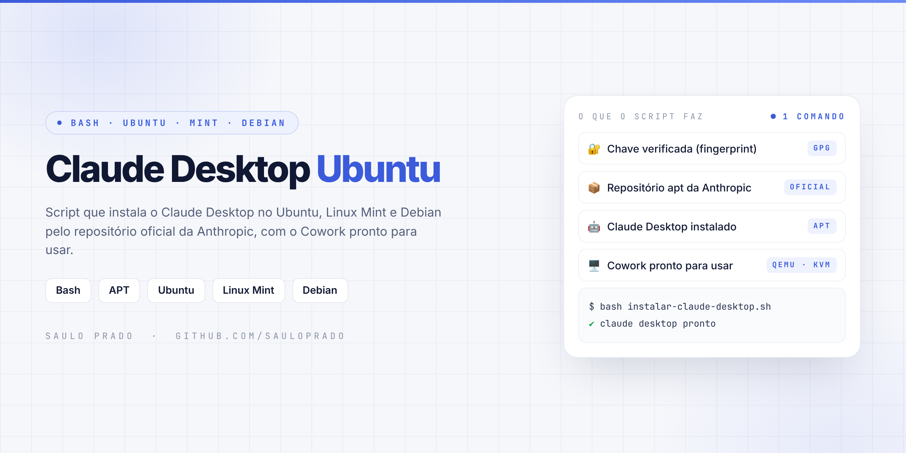
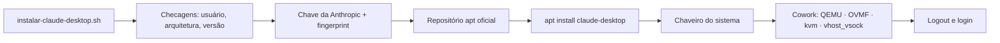

<p align="center">

</p>

<h1 align="center">Claude Desktop Ubuntu</h1>
<p align="center"><i>Script que instala o Claude Desktop no Ubuntu, Linux Mint e Debian pelo repositório oficial da Anthropic, com o Cowork pronto para usar, em um único comando</i></p>

<p align="center">


</p>

## Sumário

- [Sobre](#sobre)
- [Requisitos](#requisitos)
- [O que o script faz](#o-que-o-script-faz)
- [Como funciona](#como-funciona)
- [Como executar](#como-executar)
- [Depois da instalação](#depois-da-instalação)
- [Atualizar e remover](#atualizar-e-remover)
- [Problemas comuns](#problemas-comuns)
- [Estrutura do repositório](#estrutura-do-repositório)
- [Projetos irmãos](#projetos-irmãos)
- [Créditos](#créditos)
- [Autor](#autor)

## Sobre

Automação em **Bash** que segue, passo a passo, a [documentação oficial do Claude Desktop para Linux](https://code.claude.com/docs/en/desktop-linux): registra o repositório apt da Anthropic, confere a chave de assinatura, instala o app e prepara o **Cowork**, que no Linux roda tarefas em uma máquina virtual com QEMU e KVM.

Como o pacote vem do repositório oficial, as atualizações chegam junto com as atualizações do sistema.

> O Claude Desktop para Linux está em **beta**. Oficialmente a Anthropic suporta Ubuntu e Debian; derivados como Linux Mint, Pop!_OS e Zorin OS funcionam porque usam a mesma base.

## Requisitos

| Item | Mínimo |
| --- | --- |
| 🐧 Sistema | Ubuntu 22.04+, Linux Mint 21+ ou Debian 12+ |
| 🧩 Arquitetura | amd64 (x86_64) ou arm64 |
| ⚙️ Cowork | Virtualização (VT-x / AMD-V) ativada na BIOS/UEFI |

O Linux Mint 20 e o Ubuntu 20.04 não são compatíveis: o pacote exige `libc6 >= 2.34`.

## O que o script faz

| Etapa | Na prática | Ferramenta |
| --- | --- | --- |
| 🔎 Checagens | Bloqueia root, valida arquitetura e a base do sistema | `os-release` · `dpkg` |
| 🔐 Chave | Baixa a chave da Anthropic e confere o fingerprint `31DD…ECACE`; se não bater, apaga e para | `curl` · `gpg` |
| 📦 Repositório | Registra o repositório apt oficial em `/etc/apt/sources.list.d/claude-desktop.list` | APT |
| 🤖 Claude Desktop | Instala o `claude-desktop` com os pacotes recomendados | APT |
| 🔑 Login salvo | Garante o chaveiro do sistema (GNOME Keyring ou KDE Wallet) | `gnome-keyring` |
| 🖥️ Cowork | QEMU + firmware UEFI, grupo `kvm` e módulo `vhost_vsock` carregado em todo boot | QEMU · OVMF · KVM |

## Como funciona



## Como executar

```bash
git clone https://github.com/sauloprado/claude-desktop-ubuntu.git
cd claude-desktop-ubuntu

# instalação completa (app + Cowork)
bash instalar-claude-desktop.sh

# só o app, sem preparar o Cowork
bash instalar-claude-desktop.sh --sem-cowork
```

> Rode como seu usuário normal, **sem `sudo`**: o script pede a senha só quando precisa instalar pacotes. Pode rodar de novo quantas vezes quiser.

## Depois da instalação

| Passo | Como |
| --- | --- |
| Reentrar | Se o script avisar, faça **logout e login** para o grupo `kvm` valer |
| Abrir | Menu de aplicativos → **Claude**, ou `claude-desktop` no terminal |
| Entrar | Conta do claude.ai ou SSO da sua organização |
| Testar o Cowork | Abra o Cowork no app; se faltar algo, ele mostra a mensagem do requisito |

## Atualizar e remover

```bash
# atualizar (chega junto com as atualizações do sistema)
sudo apt update && sudo apt upgrade

# remover
sudo apt remove claude-desktop
sudo rm -f /etc/apt/sources.list.d/claude-desktop.list
```

## Problemas comuns

| Mensagem | Solução |
| --- | --- |
| `Unable to locate package claude-desktop` | `sudo apt update` e confira `cat /etc/apt/sources.list.d/claude-desktop.list` |
| `NO_PUBKEY BAA929FF1A7ECACE` | Rode o script de novo para baixar a chave |
| `libc6 (>= 2.34)` | Sistema antigo: atualize para Ubuntu 22.04+ / Mint 21+ |
| Login não fica salvo | `sudo apt install gnome-keyring` e desbloqueie o chaveiro |
| Cowork requires hardware virtualization (KVM) | Ative a virtualização na BIOS/UEFI |
| Sem permissão em `/dev/kvm` | Logout e login após entrar no grupo `kvm` |
| Cowork requires the vhost_vsock kernel module | `sudo modprobe vhost_vsock` e reabra o app |

Ainda não disponível no beta Linux: Computer Use e ditado por voz. O atalho global do Quick Entry funciona no X11; no Wayland depende do ambiente gráfico.

## Estrutura do repositório

```text
claude-desktop-ubuntu/
├── instalar-claude-desktop.sh   # instalação completa (--sem-cowork opcional)
├── assets/
│   └── capa.png
├── LICENSE
└── README.md
```

## Projetos irmãos

| Projeto | Distribuição | Origem do pacote |
| --- | --- | --- |
| [claude-desktop-ubuntu](https://github.com/sauloprado/claude-desktop-ubuntu) | Ubuntu · Linux Mint · Debian | Repositório apt oficial da Anthropic |
| [claude-desktop-fedora](https://github.com/sauloprado/claude-desktop-fedora) | Fedora | Repositório DNF da comunidade |

## Créditos

O Claude Desktop é da [Anthropic](https://www.anthropic.com) e é baixado direto do repositório oficial durante a execução (nada é redistribuído aqui). Passos baseados na [documentação oficial](https://code.claude.com/docs/en/desktop-linux).

Projeto pessoal, sem vínculo com a Anthropic, Canonical, Linux Mint ou Debian. Claude é marca da Anthropic; os demais nomes são marcas de seus respectivos donos.

## Autor

**Saulo Prado** · Analista de Sistemas · Gestão de Ativos de TI, orçamento, automação e dashboards

[](https://www.linkedin.com/in/saulo-prado-ab4a0b96/)
[](https://github.com/sauloprado)
